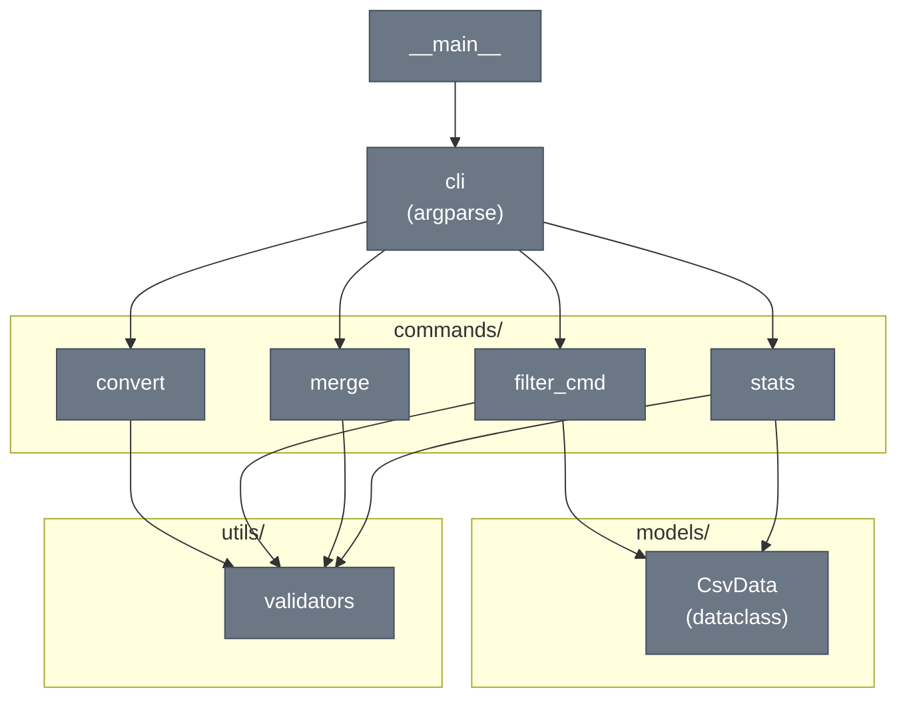
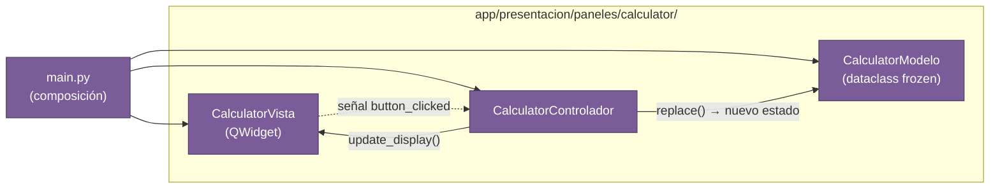
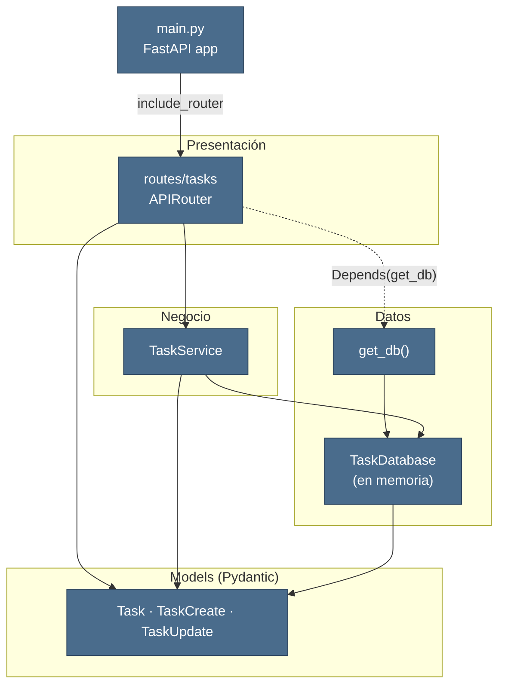
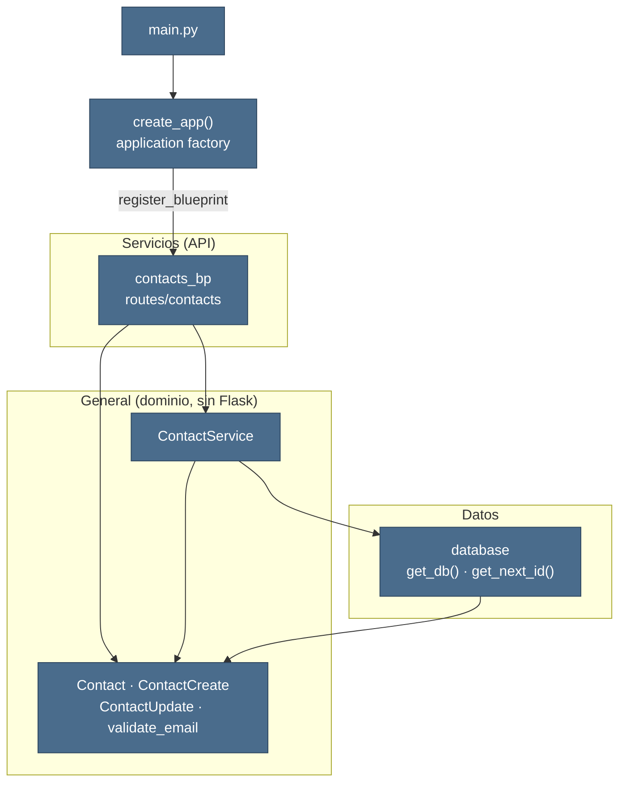
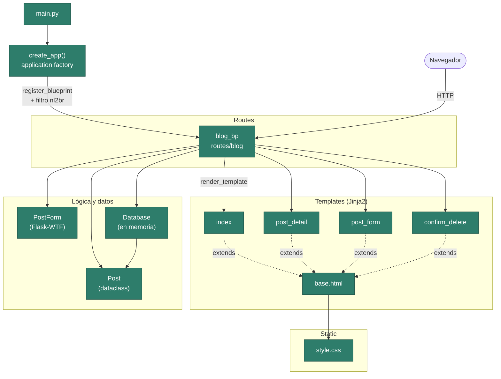
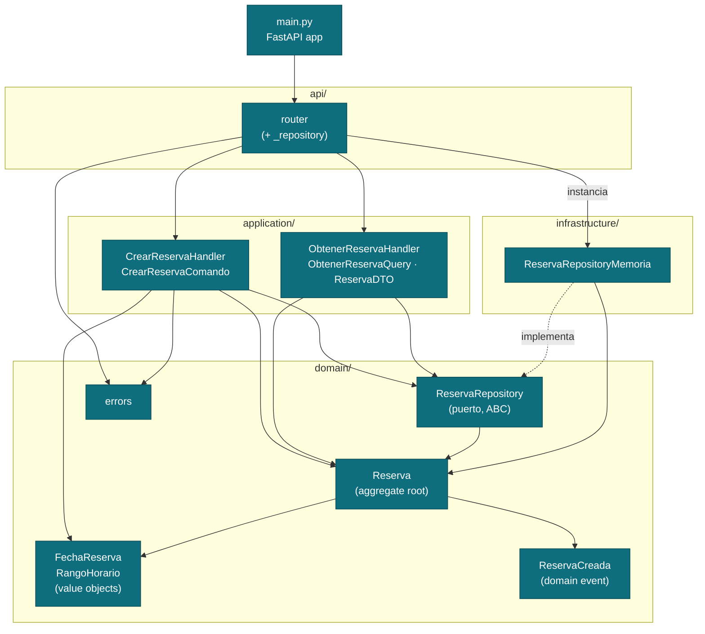
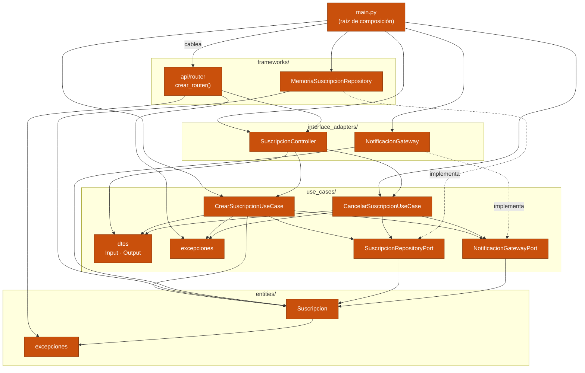

# Diagramas de componentes de los ejemplos

Un diagrama por cada proyecto de `examples/code/`, uno por perfil del framework. Las dependencias salen de los `import` reales del código, no de la arquitectura ideal. Por eso algunos diagramas muestran desvíos respecto del perfil.

Cada diagrama también está exportado como SVG en [`diagramas/`](diagramas/), listo para insertar en presentaciones o documentos.

**Convenciones**

- Flecha continua `-->`: dependencia en tiempo de compilación (un módulo importa a otro).
- Flecha punteada `-.->`: implementa una interfaz (puerto) o se conecta por señal o inyección.
- Cada recuadro agrupa los componentes de una capa del perfil.

| Perfil | Ejemplo | Estilo |
|--------|---------|--------|
| `generic-python` | `csv-tool` | Flexible |
| `pyqt-mvc` | `pyqt-calculator` | MVC |
| `fastapi-rest` | `fastapi-todo-api` | Capas |
| `flask-rest` | `flask-contacts-api` | Capas |
| `flask-webapp` | `flask-blog-app` | SSR |
| `hexagonal-ddd-bc` | `reservas-hexagonal` | Hexagonal |
| `clean-architecture-bc` | `suscripciones-clean-arch` | Clean |

---

## 1. `generic-python` — csv-tool

Sin capas impuestas: un punto de entrada, un módulo por comando y utilidades compartidas.

**Lectura**

- La estructura es plana y se entiende sin documentación. Es el caso base para contrastar con los demás.
- Nada impide que `commands` importe cualquier cosa. Funciona porque el proyecto es chico.

---

## 2. `pyqt-mvc` — pyqt-calculator

`main.py` crea las tres piezas y el controlador las conecta.

**Lectura**

- El modelo es inmutable: el controlador no lo modifica, lo reemplaza con `dataclasses.replace`.
- La vista no conoce al controlador. Solo emite una señal.
- El perfil prevé Factory y Coordinator, pero este ejemplo tiene un solo panel y no los necesita. Aparecen cuando hay varios paneles.
- El controlador importa `QMessageBox`, así que no es testeable sin Qt.

---

## 3. `fastapi-rest` — fastapi-todo-api

Capas Router → Service → Database, con Pydantic como modelos.

**Lectura**

- El flujo principal es `routes → service → db`.
- `routes` también conoce a `TaskDatabase`, porque inyecta la base con `Depends` para construir el servicio. Eso salta una capa.
- La capa de datos se llama `TaskDatabase` y no `Repository`, y el servicio depende de la clase concreta. No hay interfaz que permita cambiar la persistencia sin tocar el servicio.

---

## 4. `flask-rest` — flask-contacts-api

Mismo estilo en capas que el ejemplo anterior, con el vocabulario del perfil Flask.

**Lectura**

- La regla del perfil se cumple: `general` no importa Flask. Solo `routes` conoce `request` y `jsonify`.
- La capa de datos es un diccionario en memoria con funciones, sin clase ni interfaz.
- Comparado con el ejemplo 3, el estilo es el mismo y cambian el framework, el nombre de las capas y la forma de inyectar dependencias.

---

## 5. `flask-webapp` — flask-blog-app

Server-Side Rendering con plantillas Jinja2 que heredan de `base.html`.

**Lectura**

- Las rutas acceden directamente a la base en memoria.
- El perfil `flask-webapp` describe un BFF con un `api_client` hacia un backend separado. Este ejemplo no lo tiene: es una webapp SSR autónoma. Sirve para ver el costo de no tener capa de servicios o cliente.
- La herencia de plantillas (`extends base.html`) es el patrón visible de esta arquitectura.

---

## 6. `hexagonal-ddd-bc` — reservas-hexagonal

Bounded Context `reservas`. El dominio no importa nada de afuera.

**Lectura**

- Se cumple la regla central: nada dentro de `domain/` importa de `application/`, `infrastructure/` ni `api/`.
- El adaptador de salida (`repo`) depende del puerto, no al revés. Esa es la inversión de dependencias.
- `router` instancia el repositorio concreto, así que cumple de hecho el rol de raíz de composición.
- El docstring del router dice que no importa `domain/` directamente, pero importa `domain.errors`. Es un desvío chico y conviene discutirlo en clase.

---

## 7. `clean-architecture-bc` — suscripciones-clean-arch

Bounded Context `suscripciones`. `main.py` es la raíz de composición y arma todo.

**Lectura**

- Todas las flechas entre capas apuntan hacia adentro: `frameworks → interface_adapters → use_cases → entities`.
- Los puertos viven en `use_cases/ports/`. En el ejemplo hexagonal viven en `domain/ports/`. Esa es la diferencia estructural entre los dos estilos.
- Repositorio y gateway están en capas distintas (`frameworks` e `interface_adapters`), pero cumplen el mismo rol: implementar un puerto.
- El router importa excepciones de `entities` y de `use_cases` para traducirlas a códigos HTTP.

---

## Comparación rápida

| Ejemplo | ¿Hay interfaz entre lógica y persistencia? | Dónde se arma el grafo de objetos |
|---------|---------------------------------------------|-----------------------------------|
| csv-tool | No aplica | `cli` |
| pyqt-calculator | No aplica | `main.py` |
| fastapi-todo-api | No, el servicio usa la clase concreta | `routes` (`Depends`) |
| flask-contacts-api | No, funciones sobre un diccionario | `create_app` y llamadas directas |
| flask-blog-app | No, las rutas usan la base directamente | Módulo `database` (singleton `db`) |
| reservas-hexagonal | Sí, puerto en `domain/ports` | `api/router` |
| suscripciones-clean-arch | Sí, puerto en `use_cases/ports` | `main.py` |

Los dos ejemplos BC-first son los únicos que invierten la dependencia con una interfaz. Es lo que los diferencia del resto. El costo se ve en los diagramas: tienen más piezas por la misma cantidad de funcionalidad (el diagrama de clean tiene 13 componentes, el de hexagonal 10 y el de FastAPI 6).
